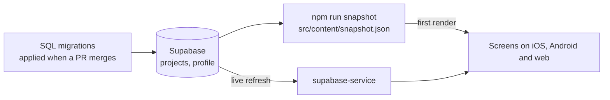

# mobile-portfolio

📱 My portfolio as a software engineer, built with Expo for iOS, Android, and web: case studies across mobile, web and back end, covering the production and personal projects I've worked on.

- **One codebase, three platforms**: Expo Router with `react-native-web`.
- **Linkable web pages**: every project has its own URL (e.g. `/project/nectar`), pre-rendered to HTML with its own title and link preview.
- **Work and personal projects**: Home lists production work and side projects in separate sections, each with its role and period.
- **Real backend**: content lives in Supabase, with a committed snapshot, so pages render instantly with real content.
- **Terminal look, readable text**: a navy terminal window on a pale sky page, sans body text with mono prompts, and one raspberry accent. Dark and light themes follow the device setting, with a sidebar layout on wide screens.

##  Try it now

The web build is live at **[arberhh.github.io/mobile-portfolio](https://arberhh.github.io/mobile-portfolio/)** — no app or simulator needed.

Since May 2026, Expo Go only opens EAS Update links for the project owner or their org members, so scanning a QR code no longer works for outside visitors.

Want to run it yourself? See [docs/SETUP.md](docs/SETUP.md) for local setup and running instructions.

## 📸 Screenshots

  
  
  

## 📁 Project Structure Overview

This project keeps code files organized in a TypeScript Expo project. Routes live in `app/` (Expo Router) and re-export the screens in `src/screens`, which are built from reusable pieces in `src/components`. The context folder holds app-wide state, and themes keep the styling the same everywhere.

See [docs/ARCHITECTURE.md](docs/ARCHITECTURE.md) for a full technical breakdown — data flow, web-specific behavior, theming, and CI/CD.

## 🎨 Design

The terminal identity stays (`$ whoami`, `$ ls ./work`, mono paths) with real hierarchy on top. Colours are sky `#CFE3F1`, white, navy `#0B2545` and raspberry `#D81B72`, and raspberry is used only for the `$`, the cursor, the main button, one highlight per card, focus rings and graph peaks. Every text pair passes WCAG AA in both themes.

The static HTML is dark, so a light-device visitor would see a flash on load. A small inline script hides the page until the right theme is applied, then entrance animations play once; reduced motion and no-JavaScript visits still show everything. See [docs/ARCHITECTURE.md](docs/ARCHITECTURE.md) for how that works.

## 💾 Supabase

This app uses Supabase as its backend. It's not just a demo — it shows I can set up and use a real backend. I use Supabase to store and show my projects, domains, and profile info. A copy of that content is committed as a snapshot (`src/content/snapshot.json`), so the app and the pre-rendered web pages have real content from the first render, and the live data refreshes it afterwards.

## 🔒 Security

This repo is checked automatically so it's safe to clone and run:

- **[CodeQL](.github/workflows/codeql.yml)** static analysis scans the JS/TS source on every push, PR, and weekly, for common vulnerability patterns.
- **[Dependabot](.github/dependabot.yml)** opens weekly PRs for outdated/vulnerable npm and GitHub Actions dependencies, and raises alerts for known CVEs.
- **`npm audit`** runs in [CI](.github/workflows/ci.yml) on every PR/push, gated at high severity.
- The app itself only holds a public Supabase URL and anon key (`EXPO_PUBLIC_*` env vars), scoped by row-level security policies to public, read-only access on the `projects`, `domains`, `project_domains`, and `profile` tables — there's no user auth or write path in the client.

See [SECURITY.md](SECURITY.md) for how to report a vulnerability.

---

Expo icon by [Icons8](https://icons8.com).
