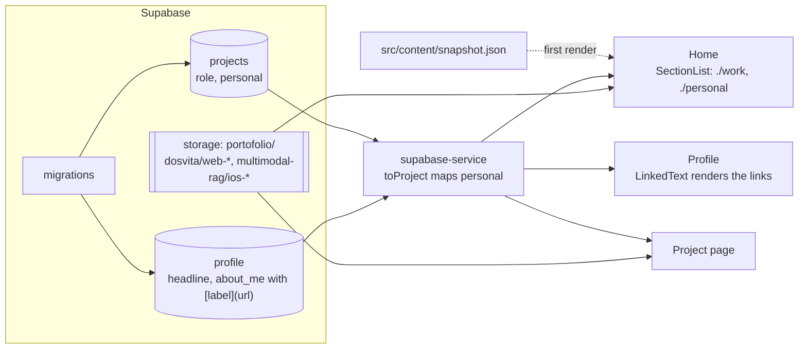

# Spec: present the portfolio as a software engineer's

Branch `feature/software-engineer-copy`.

## Purpose

The portfolio read as a mobile-only developer's, and the project pages repeated the same facts in several sections. The work since then (Dosvita on the web, a RAG app with an API and a vector database) is broader than mobile. This change:

- repositions the profile as **Senior Software Engineer**, with role titles per project that match the CV (mobile work stays "Mobile Engineer").
- separates **work** projects from **personal** ones on Home.
- adds two personal projects: **Dosvita** (live web app, desktop screenshots) and **Multimodal RAG** (side project, iOS screenshots).
- lets profile text carry inline links, so the about text links to dosvita.app and the RAG repo.
- trims the repeated copy on project pages.

## Expected user flow

1. Home shows `$ whoami`, the name, "Senior Software Engineer" and the intro.
2. Below it, `$ ls ./work` lists Nectar, AQ Shop, ArcadeQuest and Twig, each with its role (e.g. "Senior Mobile Engineer · JubileeMedia").
3. `$ ls ./personal` lists Multimodal RAG, Dosvita and Portfolio App.
4. Opening Multimodal RAG shows iPhone screenshots and a GitHub link; opening Dosvita shows browser screenshots.
5. Profile's about text has two underlined links: "Dosvita" opens https://dosvita.app, "multimodal RAG app" opens the GitHub repo, each in a new tab on web.

## How it fits together

- **Content** changes only through migrations, applied when the PR merges:
  - `20261022230000_reposition_profile_as_software_engineer.sql`: headline and about text
  - `20261022231000_add_dosvita_project.sql`
  - `20261027100000_trim_project_copy.sql`
  - `20261109100000_add_multimodal_rag_project.sql`
  - `20261109110000_retitle_project_roles.sql`
- **Images** are already uploaded to the live `portofolio` bucket, so the migrations can merge as they are.
- **Code:**
  - `personal` is added to the `Project` type and mapped in `toProject`.
  - `groupProjects` in `src/screens/projects` builds the two sections and leaves out an empty one.
  - `LinkedText` (`src/components/linked-text`) turns `[label](https://…)` into links: an `<a>` on web, `Linking.openURL` on native.
- **Snapshot** is refreshed, so the first render already shows the new content.

## Verification

Run against local Supabase with every migration applied:

- Home renders both sections in order.
- Both project pages load their new images.
- Nectar shows "Senior Mobile Engineer · JubileeMedia".
- Profile links point to `https://dosvita.app` and `https://github.com/arberhh/multimodal-rag`.
- There are no console errors.
